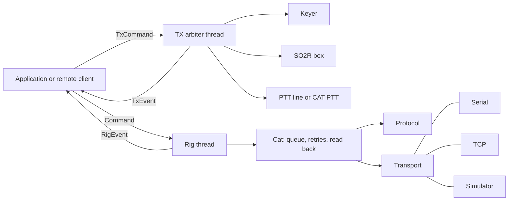
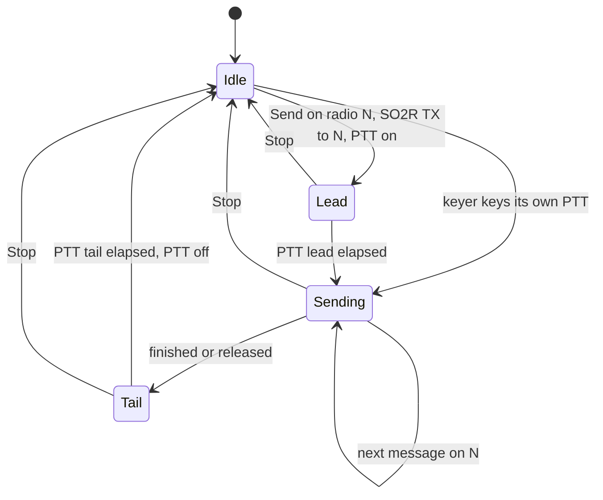
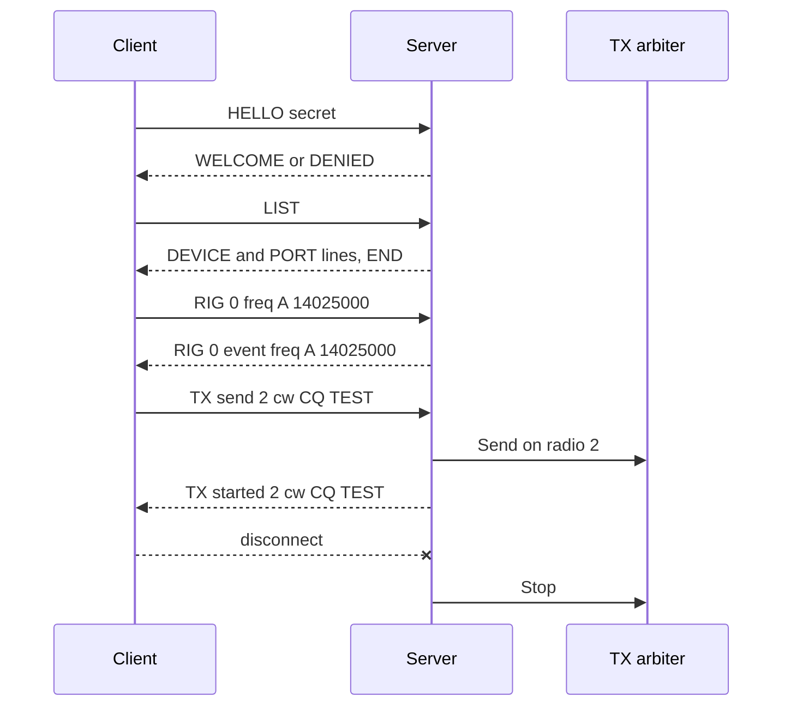

# HaML


HaML is a Rust library for amateur-radio station devices: CAT rigs, CW keyers, SO2R boxes and PTT lines, with one TX arbiter, simulators of every device, and remote operation over TCP.
Each device runs on a thread of its own, takes commands from a channel and sends state changes back; there is no async and no global state.

## Get Started

```toml
[dependencies]
haml = { git = "https://github.com/nextzlog/haml", features = ["serial"] }
```

```rust
use haml::rig::{RigClient, RigDriver};
use haml::{Cat, Command, Config, Model, Rig, RigCaps, SerialTransport, Vfo};

let model = Model::find("IC-7300").unwrap();
let port = SerialTransport::open("/dev/ttyUSB0", model.baud, model.stop_bits)?;
let device = RigDriver::spawn(Cat::new(model.protocol(), port, Config::for_baud(model.baud)));
let mut rig = RigClient::new(&device, RigCaps::ALL);
rig.send(Command::SetFreq(Vfo::A, 14_025_000), std::time::Instant::now());
```

## Build

```sh
$ cargo build --release
$ cargo test --workspace --all-features
$ cargo run --release -p haml --example bench
$ cargo run --release -p haml-ui
```

## Architecture



| Module | Role |
|---|---|
| `device` | One thread per device: commands in, events out to every subscriber |
| `ports` | Serial and HID listing reported only on change, reconnection by VID, PID and serial number |
| `rig` | CAT protocols of Icom, Kenwood, Elecraft and Yaesu, the model table and the `Cat` client |
| `keyer` | WinKeyer, USBIF4CW and serial-line keyers |
| `so2r` | SO2R Neo and OTRSP boxes, and the operator: focus, RX audio, alternate CQ |
| `tx` | The single TX arbiter |
| `sim` | Simulated rigs, keyers and boxes behind the same traits |
| `remote` | Server and client over TCP, behind the `remote` feature |

The crate has the features `serial`, `hid` and `remote`, all off by default.

## TX Arbiter

Only the arbiter keys a transmitter, so two radios never transmit at once.
A request for another radio waits until the current one is released.
CW timing is left to the keyer, FSK goes to a device that can key it, and otherwise the application is asked for AFSK.
Voice on a radio without a PTT line of its own is keyed by the phone PTT of the keyer.
The SO2R box is told the TX radio only when it changes, and the keyer, the box and the PTT lines may be replaced while the arbiter runs.



## Remote Operation

A server exposes the rigs and the arbiter of its station, and a client implements the same `Rig`, `Keyer`, `So2r` and `Ptt` traits by proxy.
Only high-level commands cross the network, never CAT bytes or keying timing, and every TX request goes through the arbiter of the server.
A lost client or an emergency stop releases all PTT and aborts the keyer.
The listing carries the capabilities of each rig, and a keyer of the client may follow the radio its SO2R box was last told.



## Protocol Coverage

| Operation | Icom | Kenwood | Elecraft | Yaesu ASCII | Yaesu binary |
|---|---|---|---|---|---|
| Frequency | yes | yes | yes | yes | current VFO |
| Mode | yes | yes | yes, with DATA | yes | yes |
| VFO A/B | yes | yes | yes | yes | toggle |
| Split | yes | yes | yes | yes | yes |
| PTT | yes | yes | yes | yes | yes |
| RIT and XIT | yes | yes | yes | yes | RIT only |
| Transceive | rig menu | `AI` | `AI` | `AI` | no |

## Bench

The bench sends 2,000 frequency and mode commands to each protocol over a clean, a lossy and a harsh simulated link.

| Protocol | Link | Success | Retries | Mean | p95 |
|---|---|---|---|---|---|
| Icom CI-V | clean | 100.00% | 0 | 20.0 ms | 20.0 ms |
| Icom CI-V | harsh | 99.80% | 637 | 146.1 ms | 357.0 ms |
| Kenwood | harsh | 99.90% | 628 | 71.3 ms | 198.0 ms |
| Yaesu ASCII | harsh | 100.00% | 524 | 70.0 ms | 195.0 ms |
| Yaesu binary | harsh | 100.00% | 240 | 63.3 ms | 238.0 ms |


## License

Licensed under the [MIT License](LICENSE).
